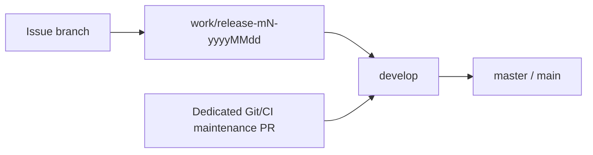

# Git process

Tracking: [#97](https://github.com/tuanvipandpro/quiz-app/issues/97). This is the canonical branch/routing policy. See [contributing](contributing.md) for change classification, verification, secrets and release acceptance.

## Branch routing

| Target                                        | Source                                            | Purpose                                                                    |
| --------------------------------------------- | ------------------------------------------------- | -------------------------------------------------------------------------- |
| `master` (or `main` after an explicit rename) | **`develop` in this same repository only**        | Accepted production promotion                                              |
| `develop`                                     | Accepted milestone release                        | Integrate a completed milestone                                            |
| `develop`                                     | Dedicated repository-governance/CI maintenance PR | Bootstrap or maintain this process; keep separate from product feature MRs |
| `work/release-mN-yyyyMMdd`                    | Issue branch based on that release                | One cohesive issue's implementation                                        |
| Existing milestone release                    | `develop` through an explicit baseline-sync PR    | Bring accepted governance/hotfix baseline into an already-created release  |



The production branch is currently `master`; do not create or rename it to `main` implicitly. A fork branch named `develop`, a milestone release, a feature branch or a direct hotfix branch is not an accepted production PR source. Bring fixes through `develop` before production promotion. Repository identity uses both the repository name and immutable ID.

GitHub branch protection does not prevent someone opening a wrong-source PR. The required `pr-source-policy` check rejects its merge and handles base edits, so acceptance from an earlier integration target is reevaluated. This ordinary PR check is read-only, has a unique job name and never creates a skipped push-event success.

PR head code can edit its own ordinary workflow, so production also has a trusted routing guard. Its `pull_request_target` workflow checks out exactly the protected base SHA, installs no dependencies and never checks out or executes head code. It refreshes current PR metadata before deciding, so a queued event does not close a PR already moved to an integration base. With only read-content/pull-request-state permission, it closes the exact wrong-source production PR; valid same-repository develop PRs cause no API mutation. It never publishes commit-scoped verdicts that could conflate different PRs sharing a head SHA. API failure or an already-merged response is reported as enforcement failure, not successful closure. This guard becomes active when the governance workflow reaches production through the permitted develop promotion. No provider secret, production data or inference is used. CI/policy changes still require review; administrators retain the ability to edit repository settings.

## Branches and milestones

1. Update the protected `develop` baseline through accepted PRs. Create a release from its current commit, named `work/release-mN-yyyyMMdd`: positive milestone number and real calendar date in Asia/Saigon. Current M1 is `work/release-m1-20261106`; M2/M3 get their own dated branches.
2. Start each issue branch from that release. Use descriptive `codex/` names including the issue number where practical, for example `codex/80-exam-history`. Existing M1 branch names remain valid; do not rewrite working history merely to rename them.
3. Target issue PRs at their milestone release. Keep one cohesive issue per MR. Preserve stable data IDs, account isolation and the issue's independent acceptance/rollout gates while resolving shared code changes.
4. When the milestone is accepted, open release → `develop`, then `develop` → production PRs. Use merge commits for these shared-branch promotions to preserve ancestry for future milestones. Do not squash/reset shared development history or force-push protected branches.

## Protection and CI

- Production and `develop` require PRs, up-to-date bases, GitHub Actions `test-and-build`, resolved conversations and administrator enforcement. Force pushes, branch deletion and bypass grants are disabled. Zero independent required approvals permits the single-maintainer workflow; it does not waive PR/check or owner-requested merge requirements.
- Production additionally requires GitHub Actions **`pr-source-policy`**. It accepts only same-repository `develop`. The shared API configuration is [branch-protection.json](../.github/branch-protection.json); [git-process.mjs](../scripts/git-process.mjs) generates the role-specific production payload without duplicating or mutating the develop policy:

  ```sh
  node scripts/git-process.mjs protection master
  node scripts/git-process.mjs protection develop
  ```

- CI validates production, `develop` and dated milestone releases. Its baseline is a successful same-target-branch workflow run from this repository, with Git ancestry validation. Missing or untrusted evidence selects full verification. Prior-base green checks do not prove a moved/updated PR's current integration.
- Only a push to the main/master repository default branch can publish production artifacts, after the existing runtime-diff/component, same-run build, credential and migration gates. Release/develop pushes validate without deploying. PRs never deploy.
- The lightweight source-policy workflow handles `edited` events independently. PR text edits do not restart the heavy pipeline. Refresh full CI by updating the PR head against its target when the integration base changes.

## Issue, commit and MR lifecycle

Create/reuse the tracking issue before implementation and record type, risk and acceptance. Write documentation in English. Use descriptive commit subjects and `Refs #N`; do not use automatic issue-closing keywords. Link issue/PR in both directions. Report the final behavior and actual tests/limitations; keep screenshots/logs/traces ignored or in CI artifacts.

Before push, inspect staged files and all outgoing commits and run the redacted secret scans in [secret handling](contributing.md#credentials-and-secrets). Use the applicable [verification plan](contributing.md#classify-work-and-scale-documentationtests). Wait for required checks on the latest head. Merge only when the owner requests it; never use administrator bypass, weaken checks, fabricate status results or merge a feature because a process change was approved.

A merge into a milestone release is integration. Keep delivery issues open until their accepted scope, production promotion, post-merge CI/deploy and applicable real smoke/rollout checks pass. Firebase publication, history enablement and live AI usage retain their separate authorization and account/budget requirements.

## Current governance bootstrap

The dedicated Git-process MR targets `develop`, retaining the earlier branch-aware CI bootstrap and adding production-source enforcement. The older unmerged release-targeted setup MR is superseded, not delivered or used as permission to merge features.

After the governance MR is accepted into `develop`, synchronize that accepted baseline into the already-created M1 release through a checked baseline-sync PR. Then update the M1 issue heads and verify actual current-base checks. M1 delivery MRs #89–#95 and coordination #88 continue targeting the M1 release; #92 remains draft until #89 is integrated there. No product feature is merged by this bootstrap. Production itself receives the process only via the permitted `develop` promotion.

## Verification and configuration changes

Policy tests cover same-repository production promotion, wrong source branches, forks named develop, missing/mismatched metadata, base changes and immutable role-specific protection. The CLI uses synthetic event files. Trusted-guard tests verify exact-PR closure, same-SHA independence, valid-source zero writes, mismatched-base rejection and API failures through a stub fetch. They close no real PRs. Use local fixtures/emulators for routine application tests; metadata-policy tests need no live account or credential.

When applying branch settings, review the generated payload against current remote settings, preserve unrelated requirements, and verify API readback of the pinned check providers/admin/PR/force/delete controls. Do not silently replace drifted settings. Do not infer enforcement from a dry-run push. Keep policy/routing changes reviewable in their own PR and record actual configuration/CI evidence in the tracking issue.
