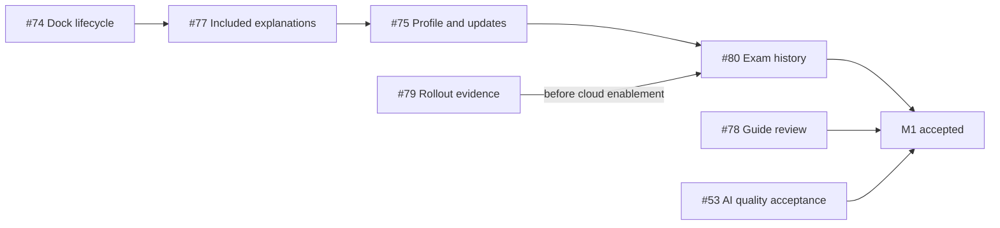

# M1 implementation plan

Planning coordination: [#87](https://github.com/tuanvipandpro/quiz-app/issues/87). [Milestone 1](https://github.com/tuanvipandpro/quiz-app/milestone/1). Baseline inspected: master `648d9e1`, 2026-11-05.

This document coordinates the existing M1 issues. It is a planning deliverable; implementation checklists and production acceptance remain open. One planning PR covers this requested preparation; later work uses one focused implementation PR per issue/change, with its own evidence and owner-requested merge.

## Confirmed scope and proposed defaults

| Decision                          | M1 plan                                                                                                                                      |
| --------------------------------- | -------------------------------------------------------------------------------------------------------------------------------------------- |
| Profile scope, owner-confirmed    | Google account information plus QuizMos settings; no custom identity/avatar editor                                                           |
| History scope, owner-confirmed    | Exam history first; Practice keeps the existing draft/checkpoint flow                                                                        |
| Profile preferences, proposed MVP | Reuse device-local VN/EN and theme preferences and existing AI Settings; no new cloud preference fields                                      |
| History backend, proposed         | Existing Firestore stack through a dedicated service/store; #52 migration is outside M1                                                      |
| History limits, proposed          | 50 retained attempts/account, 20 summaries/page, 100 questions/snapshot, conservative 750 KiB client envelope; explicit deletion at capacity |
| History eligibility, proposed     | Signed-in bank and explicitly saved private-quiz exams; guests and unsaved uploads stay tab-local                                            |
| History retention, proposed       | Immutable independent archives with explicit deletion; disclose retention when a source quiz is deleted/replaced                             |
| App AI boundary CPU benchmark     | Owner-deferred in current #53 acceptance; retain deferred status, not a passing claim or a reinstated M1 gate                                |

Source facts: the catalog has 20 banks/4,389 questions and 1,036 non-empty included explanations. Four guide snapshots need substantive review. These are structural observations, not an answer-correctness audit. App AI is already active; #53 concerns remaining acceptance. #42 is closed, while its rollout evidence/documents need reconciliation through #79.

## Delivery sequence and PR boundaries

The main arrows show the recommended integration order. #78/#79/#53 can progress independently; #80's pure model/fixture work can start before the #79 release gate is cleared. Do not wait for #52 or rebuild already-shipped auth/quiz CRUD/App AI activation.

| Order/workstream       | Change / existing source                                                                                                            | Owner and focused deliverable                                                               | Relative effort / gate                                                                        |
| ---------------------- | ----------------------------------------------------------------------------------------------------------------------------------- | ------------------------------------------------------------------------------------------- | --------------------------------------------------------------------------------------------- |
| 1 — #74                | [study-dock-lifecycle-74](../openspec/changes/study-dock-lifecycle-74/proposal.md)                                                  | StudyNavigation; safe observer lifetime and a failing late-callback/navigation regression   | Small; error-free deployed route smoke                                                        |
| 2 — #77                | [included-explanations-77](../openspec/changes/included-explanations-77/proposal.md)                                                | Explanation UI/hook; direct included reading, explicit Generate AI and preserved exam gates | Medium; zero reading-triggered credential/quota/inference calls                               |
| 3 — #75                | [account-and-quiz-updates-75](../openspec/changes/account-and-quiz-updates-75/proposal.md)                                          | Profile/updates pages, menu/routing, current preferences and reviewed update registry       | Medium; account/focus/leave guards and source/date accuracy                                   |
| 4 — #80                | [exam-history-80](../openspec/changes/exam-history-80/proposal.md)                                                                  | History model/repository/store/UI; immutable private exam archives and dashboard            | Large; additive policy/index verification before enabling capture                             |
| Content — #78          | [guide-review-78](../openspec/changes/guide-review-78/proposal.md)                                                                  | Four published guides, source/mapping review and maintained counts                          | Large content-review effort; actual questions/primary references reviewed before hash updates |
| Release evidence — #79 | [custom-quizzes-42 verification](../openspec/changes/custom-quizzes-42/verification.md), [release procedure](../firebase/README.md) | Reconcile actual deployed Rules/indexes/smoke evidence and stale status documentation       | Access-dependent; no inference from a closed issue or local test                              |
| AI quality — #53       | [app-ai-worker tasks](../openspec/changes/app-ai-worker/tasks.md), [rollout record](../openspec/changes/app-ai-worker/rollout.md)   | Broader prompt-v6 output-quality review and honest acceptance reconciliation                | Evidence-dependent; CPU-boundary work remains explicitly deferred                             |

Each of the five new changes contains proposal, capability specs, design/verification matrix and unchecked implementation tasks. The baseline user-profile-access contract is preserved. Existing #79/#53 artifacts remain their source of truth; this plan does not rewrite historical evidence or mark their production steps complete.

## Work package #79: production baseline reconciliation

1. Read current #42/#79 records and locate any owner-supplied publication/smoke evidence. Distinguish historical snapshots from current published state; the old zero-login finding is not a claim about today's credentials.
2. Through an already authorized owner/admin connection, retrieve the published Rules revision and complete indexes/field overrides. Record revision/hash/time/provenance without private question contents or credentials. Compare actual deployed policy with the supplied baseline and candidate, including overlapping grants and profile access.
3. Reconcile a candidate locally if required. Run baseline/candidate emulator SDK scenarios for owner/guest/Bob, 3-slot concurrency, 1/100 question boundaries, version conflicts, replacement/checkpoints and size failures. An index fragment alone is not a deployable configuration.
4. Only when the applicable rollout/account scope is authorized, verify bounded designated-account save/read/reload/second-context/delete behavior. Keep access or live-evidence gaps open; do not use personal incidental accounts or call local fixtures production proof.
5. Update Firebase/README/OpenSpec release status with actual evidence. Preserve closed #42 history and use #79 for the follow-up. Any real Rules/index change has a reviewable PR and follows the existing release order/rollback procedure; unchanged deployed policy may need only evidence/document reconciliation.

Required outputs: provenance/drift comparison, scenario-to-evidence matrix, permitted production-smoke result and an explicit remaining-gap list. Status: not executed by this plan.

## Work package #53: output quality and accepted deferral

1. Reconcile the issue's current acceptance with historical app-ai-worker artifacts. Activation/#64 merge/deployment already have evidence. The current issue explicitly defers the boundary CPU benchmark by owner decision; keep it labelled Deferred and avoid treating a small historical p99 sample as a pass.
2. Prepare an offline review matrix covering all five question formats, single/multiple answers, ambiguity/incorrect marked answers, long options and conflicting included content. Grade captured prompt-v6 outputs for the four requested sections, correct per-choice reasoning, Vietnamese with preserved English terms and honest uncertainty. Record failures against source facts/primary references, not fixture formatting alone.
3. Use existing captured evidence first. If missing cases require new model output, define a bounded staging sample, current designated account/budget and stop conditions before running live inference. Historical unused call allowances are not a fresh unlimited authorization. Routine tests remain fixture-based; no new model, quota, plan or paid fallback is part of this work package.
4. If the review identifies a prompt/runtime correction, scope it in a focused #53 PR with prompt-version/cache compatibility tests and required Worker/UI checks. Otherwise deliver the review/evidence reconciliation only.
5. Before closure, split the status of original composite task 3.2 transparently: completed rollout, remaining/passed output quality and explicitly deferred CPU-boundary work. Do not check a combined task as fully measured when part is deferred. Record the accepted scope and actual post-merge/rollout evidence.

Required outputs: reviewed case matrix, quality findings/resolutions and coherent acceptance/deferred status. Status: not executed by this plan. CPU-boundary testing is outside this M1 critical path unless the owner reopens that scope.

## Integration and acceptance rules

- New history schema and scoped Rules are additive. No existing checkpoint, alias, private-quiz instance/version or profile-access shape is replaced. Pure client checks do not substitute for enforced ownership/quota rules.
- A saved private quiz's history is a separate owner-only archive with explicit retention/deletion UX. Unsaved JSON previews and guest drafts are never silently uploaded through history.
- Account changes abort/ignore stale IO; content changes are handled at the owning service/domain boundary. Historical scores use the archived grading context, never the current bank.
- Reuse translations, Ant Design and semantic tokens. Check 320/390/412/768/1280px and landscape, VN/EN, themes, keyboard/focus, reduced motion and relevant long content/error states. Use the 360px reported viewport for the dock regression as well. Describe emulation honestly and retain disposable evidence outside Git.
- UI guidance used during planning: error recovery retry → Error Recovery / Error Messages / Error Placement. The certification learning dashboard design-system result was a showcase/child-typography mismatch; the narrower developer dashboard minimal retry supplied useful dark/focus/contrast guidance but an unsuitable FAQ/landing structure. Preserve the existing dual-theme app design and do not import either suggested font/palette/layout wholesale.
- Each implementation group lands its own regression tests and documentation with the behavior. The design matrices map stable CQ requirement IDs to planned evidence; replace Pending only with actual results.

## Verification by work type

| Work                       | Required local plan                                                                                            | Required delivery evidence                                                                                |
| -------------------------- | -------------------------------------------------------------------------------------------------------------- | --------------------------------------------------------------------------------------------------------- |
| This planning-only PR      | Strict SDD validation, changed-file formatting, documentation links/config checks; no runtime acceptance claim | Latest-head selected CI; owner review/merge when requested                                                |
| #74/#77/#75                | yarn verify, relevant E2E and actual rendered UI checks                                                        | Latest-head CI, owner-requested merge, master deploy and focused smoke                                    |
| #78                        | Actual content/primary-source review, check:guides/catalog, guide tests, yarn verify and relevant E2E          | Reviewed source/mapping matrix and deployed guide/link/status smoke                                       |
| #80                        | Domain/fixture tests, real demo Firestore Rules/transaction tests, yarn verify/E2E and build isolation         | Verified compatible production policy/indexes before capture enablement; bounded authorized archive smoke |
| #79/#53 evidence-only work | Appropriate provenance, document/link and scenario review; no broad unchanged-suite rerun for prose alone      | Current-policy/live evidence where required; gaps/deferred items remain explicit                          |

M1 completion requires accepted evidence for its actual scope, merged required implementation PRs and required post-merge/rollout checks. Five planningComplete statuses or the milestone's issue counts do not establish implementation completion. #87 tracks this preparation only; #74/#75/#77/#78/#79/#80/#53 stay open until their own delivery criteria are satisfied.

## Next implementation entry

After reviewing/merging this planning PR, start with `study-dock-lifecycle-74` using the apply workflow. Advance one issue/change at a time and keep the milestone/issue evidence current. Feature implementation begins on a new owner request; this planning invocation does not enter apply.
