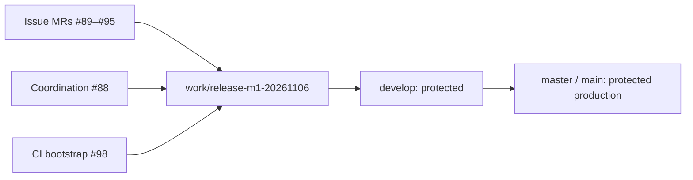

# M1 delivery coordination

Tracking: [#87](https://github.com/tuanvipandpro/quiz-app/issues/87), [Milestone 1](https://github.com/tuanvipandpro/quiz-app/milestone/1). Branch-flow migration: [#97](https://github.com/tuanvipandpro/quiz-app/issues/97), [setup MR #98](https://github.com/tuanvipandpro/quiz-app/pull/98). Status reconciled 2026-11-06 (Asia/Saigon).

Each of the seven delivery issues keeps its original issue MR, code/content, specs and evidence. This MR owns only M1 coordination. All seven delivery MRs and coordination #88 now target `work/release-m1-20261106`, created from `develop` at the production baseline `648d9e1`. Production is currently named `master`; no rename or feature merge is implied by retargeting.

## Confirmed product scope

- Profile: read-only Google information plus existing QuizMos language/theme settings; identity/avatar editing is outside the MVP.
- History: Exam first; Practice keeps current drafts/checkpoints. #80 implements 50 retained private attempts, 20-row metadata queries, immutable scored snapshots, independent archive retention and minimal disclosed anti-replay receipts.
- App AI activation already shipped. Wider v6 quality remains in M1; the CPU-boundary benchmark is owner-deferred, not passed or reinstated as a gate.
- Storage migration #52 and Practice event/revision queues remain outside M1.

## Milestone integration flow

Create each future `work/release-mN-yyyyMMdd` from the then-current `develop`, using the milestone number and Asia/Saigon calendar date. Issue branches target that milestone release. After acceptance, promote with PRs release → develop → production; use merge commits for promotions to preserve ancestry. The production/default branch and `develop` require PRs and current-base `test-and-build` from GitHub Actions, including admins; force push/deletion/bypass are blocked. A single-maintainer flow has zero independent required approvals while retaining PR/CI gates.

No application is deployed from a milestone release or `develop`. The production workflow publishes only on the main/master repository default branch, after the existing component/release/artifact/migration gates. Branch protection changes are GitHub repository policy; Firebase policy publication, history enablement and real AI usage retain separate authorization/acceptance.

## Seven issue MRs

| Issue                                                      | MR                                                       | Implemented/prepared evidence                                                                                                                                                   | Remaining acceptance                                                                                                                       |
| ---------------------------------------------------------- | -------------------------------------------------------- | ------------------------------------------------------------------------------------------------------------------------------------------------------------------------------- | ------------------------------------------------------------------------------------------------------------------------------------------ |
| [#74](https://github.com/tuanvipandpro/quiz-app/issues/74) | [#89](https://github.com/tuanvipandpro/quiz-app/pull/89) | Dock observer lifecycle corrected; local regression/prior-base CI passed.                                                                                                       | Current release CI, owner-requested issue merge, milestone promotion and public dock smoke.                                                |
| [#77](https://github.com/tuanvipandpro/quiz-app/issues/77) | [#90](https://github.com/tuanvipandpro/quiz-app/pull/90) | Included references open without credential/profile/quota/inference IO; explicit AI generation; local/prior-base CI passed.                                                     | Integrate after #89 on the release; required CI, issue merge, promotion and public reference-only smoke.                                   |
| [#75](https://github.com/tuanvipandpro/quiz-app/issues/75) | [#91](https://github.com/tuanvipandpro/quiz-app/pull/91) | Profile, Manage quizzes, reviewed Quiz updates and native-hash Cancel fix; local/prior-base CI passed.                                                                          | Integrate after #90; required release CI, issue merge, promotion and account/public smoke.                                                 |
| [#80](https://github.com/tuanvipandpro/quiz-app/issues/80) | [#92](https://github.com/tuanvipandpro/quiz-app/pull/92) | Archive/dashboard/review/delete and atomic policy implemented; 220 Node, 27 real SDK/Rules and 32 History UI checks passed on the recorded #74 foundation. Client defaults off. | Draft: bootstrap #98, #89 on release, update/current-base CI; compatible policy/index publication and designated-account production smoke. |
| [#78](https://github.com/tuanvipandpro/quiz-app/issues/78) | [#93](https://github.com/tuanvipandpro/quiz-app/pull/93) | Four guides reviewed, all 554 current IDs mapped; bank files/answers unchanged. Local/prior-base CI passed.                                                                     | Required release CI, issue merge, promotion and published guide/link smoke; #96 is separate bank-content follow-up.                        |
| [#79](https://github.com/tuanvipandpro/quiz-app/issues/79) | [#94](https://github.com/tuanvipandpro/quiz-app/pull/94) | Published Console policy/index provenance reconciled; complete candidate/SDK tests prepared; prior-base CI passed.                                                              | Required release CI, explicit policy-publication permission, fresh drift check and designated-account custom-quiz smoke.                   |
| [#53](https://github.com/tuanvipandpro/quiz-app/issues/53) | [#95](https://github.com/tuanvipandpro/quiz-app/pull/95) | One retained v6 output reviewed; eight missing-case samples/protocol prepared; 193 Node/18 local Worker checks, dry-run and prior-base CI passed.                               | Draft: required release CI, current account/eight-attempt staging authorization and actual quality findings; CPU stays deferred.           |

These counts and prior green checks identify earlier verified integration states; they are not a new-base CI pass. The full History integration run had 200 passes, 24 local loading timeouts and two intentional skips; a focused unchanged serial rerun passed all 24 failures. Retained traces and per-issue matrices remain authoritative, not a combined full-run or production claim.

## Bootstrap and dependency order

First merge the checked setup MR #98 into the milestone release when the owner requests it. Until then, the release and existing feature heads carry the previous master-only workflow; retargeting alone cannot establish branch-aware current-base checks. #98's opening PR exercises the new release-target trigger. After bootstrap, update feature heads against the release and verify their actual checks; do not treat old planning/prior-base checks as sufficient.

The main feature order within the release remains #89 → #90 → #91 → #92. #93/#94 progress independently; #95 still needs actual quality acceptance. Handle shared App/header changes in the appropriate issue branch. Neither a workflow migration nor a CI setup merge authorizes merging these feature MRs.

#92 was replayed from its original #80 plan plus unchanged History runtime/tests, removing inherited #74 commits from the former stacked branch. Its issue-only release diff does not duplicate the dock correction. The earlier verified combination remains History `599a5ec` plus dock foundation `f3cf769`; its new source does not inherit that dock fix. Land #89 on the release first, update #92, and pass required CI before a requested History merge. Keep #75 navigation and #79 policy reconciliation during integration.

## Release and closure gates

- #79 observed a parent-profile-only published policy with no custom-quiz descendant grant and no manual indexes/exemptions. Publish its complete candidate only with explicit permission after rechecking drift. History's additional policy/index candidate and client enablement are separate.
- Pending production-policy/designated-account and at-most-eight staging AI requests remain pending, not consent. The old request to merge #89 directly into master is superseded by this milestone flow; subsequent issue integration targets the release.
- Preserve IDs/aliases, account drafts/checkpoints and private instance/version identity. No guest migration or silent archive pruning. Use existing UI tokens/components and the verified 320/360/390/412/768/1280 plus landscape, VN/EN/theme/focus/motion acceptance; emulation is not physical-device evidence.
- An issue merge into the milestone release is integration, not production delivery. Promote the accepted release through protected `develop` and production with owner-requested PR merges, required latest-head/master-or-main CI/deploy and the issue's real public/designated-account smoke before closing a delivery issue.
- Keep per-issue tasks and evidence current. Local fixtures/emulators cannot replace real persistence, model quality or rollout acceptance. No M1 feature merge, Firebase publication or additional live inference was performed by this migration.

## Coordination verification

This MR changes only this document. Check formatting, links, MR mapping and dependency/branch facts, scan outgoing commits and wait for its current release-base CI after bootstrap. #87 owns preparation/coordination; merging this document does not complete M1 or close the seven delivery issues.
