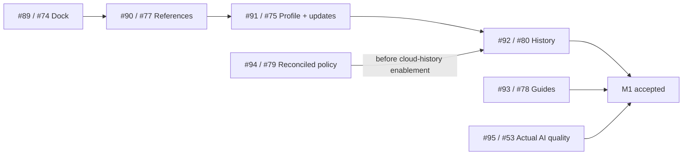

# M1 delivery coordination

Tracking: [#87](https://github.com/tuanvipandpro/quiz-app/issues/87), [Milestone 1](https://github.com/tuanvipandpro/quiz-app/milestone/1). Implementation status reconciled 2026-11-06; inspected master baseline `648d9e1`.

This MR owns only sequencing and acceptance coordination. Each of the seven delivery issues continues in its original issue MR, including its code/content, specs, tests and maintained evidence. No delivery payload is bundled into this coordination diff. M1 is not complete while integration, output-quality or production acceptance remains open.

## Confirmed scope

- Profile: read-only Google account information plus the existing QuizMos language/theme settings; identity/avatar editing is outside the MVP.
- History: Exam first; Practice retains current drafts/checkpoints. #80 implements 50 retained private attempts, 20-row metadata queries and immutable scored snapshots. Independent saved-quiz archive retention and minimal anti-replay receipts are disclosed.
- App AI activation already shipped. Wider v6 output quality remains in M1. The CPU-boundary benchmark is explicitly owner-deferred and is neither a passing claim nor a reinstated M1 gate.
- Storage migration #52 and Practice event/revision queues remain outside M1.

## Seven issue MRs

| Issue                                                      | MR                                                       | Implemented/prepared result                                                                                                                                      | Remaining acceptance                                                                                                                   |
| ---------------------------------------------------------- | -------------------------------------------------------- | ---------------------------------------------------------------------------------------------------------------------------------------------------------------- | -------------------------------------------------------------------------------------------------------------------------------------- |
| [#74](https://github.com/tuanvipandpro/quiz-app/issues/74) | [#89](https://github.com/tuanvipandpro/quiz-app/pull/89) | Stale dock measurements ignored after unmount/replacement; local regression and required CI passed.                                                              | Owner-requested merge, master CI/deploy and public dock smoke.                                                                         |
| [#77](https://github.com/tuanvipandpro/quiz-app/issues/77) | [#90](https://github.com/tuanvipandpro/quiz-app/pull/90) | Included references open without key/profile/quota/inference IO; AI generation is explicit. Local acceptance and required CI passed.                             | Integrate after #89; owner-requested merge/deploy and reference-only public smoke.                                                     |
| [#75](https://github.com/tuanvipandpro/quiz-app/issues/75) | [#91](https://github.com/tuanvipandpro/quiz-app/pull/91) | Profile, Manage quizzes, reviewed Quiz updates and native-hash Cancel correction; local acceptance and required CI passed.                                       | Integrate after #90; owner-requested merge/deploy and account/public smoke.                                                            |
| [#80](https://github.com/tuanvipandpro/quiz-app/issues/80) | [#92](https://github.com/tuanvipandpro/quiz-app/pull/92) | Exam archive/dashboard/review/delete and atomic Rules implemented; 220 Node, 27 real SDK/Rules and 32 History UI checks passed. Client defaults off.             | Draft stacked on #89; master integration/latest-head CI, compatible policy/index publication and designated-account persistence smoke. |
| [#78](https://github.com/tuanvipandpro/quiz-app/issues/78) | [#93](https://github.com/tuanvipandpro/quiz-app/pull/93) | Four guides substantively reviewed, all 554 current IDs mapped; bank files/answers unchanged. Local/content-head CI passed.                                      | Acceptance-record head CI, owner-requested merge/deploy and published guide/link smoke. #96 is separate bank-content follow-up.        |
| [#79](https://github.com/tuanvipandpro/quiz-app/issues/79) | [#94](https://github.com/tuanvipandpro/quiz-app/pull/94) | Published Console policy/index provenance reconciled; complete candidate and real SDK tests prepared; required CI passed.                                        | Explicit policy-publication permission, fresh full-config drift check and designated-account bounded custom-quiz smoke.                |
| [#53](https://github.com/tuanvipandpro/quiz-app/issues/53) | [#95](https://github.com/tuanvipandpro/quiz-app/pull/95) | Historical v6 single-answer output reviewed; eight public missing-case samples and bounded protocol prepared. 193 Node/18 local Worker tests and dry-run passed. | Draft: latest-head CI, current account/budget authorization and actual output-quality findings; CPU benchmark stays deferred.          |

The full History integration run had 200 passes, 24 local loading timeouts and two intentional skips; all 24 failed cases passed in a focused serial rerun with unchanged source/assertions/timeouts. The original run is not reported as green. Each issue MR records its own precise evidence, retained diagnostics and limitations; these are not combined-suite or production-acceptance claims.

## Integration and release order

The main UI integration sequence is #89 → #90 → #91 → #92, checking/rebasing each current head and resolving shared header/App changes before its required CI. #93 and #94 can integrate independently when their checks and owner-requested merge gates are satisfied. #95's preparation/CI does not satisfy its missing model-quality review.

#92 is temporarily based on `codex/plan-study-dock-74`: its own diff excludes the #74 fix while local tests consume verified foundation `f3cf769`. The workflow currently triggers PR checks only against master, so #92 has **no current feature-head CI pass**. After the owner requests #89 merge, integrate/retarget #92 to master and wait for required CI on that resulting head. Do not use its old planning checks or waive the gate. Retain #75's account navigation during integration.

#79 observed a published parent-profile-only policy with no custom-quiz descendant grant, and no manual indexes/exemptions. Its complete custom-quiz candidate still needs explicit publication authorization and fresh drift reconciliation. #80 adds its own policy/payload-index contract; approval of the custom-only candidate does not authorize the history candidate or enable its client. Publish and verify compatible complete Rules/indexes before history enablement. Preserve unrelated configuration and roll back the client setting first.

## Shared acceptance and owner actions

- Keep stable question IDs/aliases, account-scoped drafts/checkpoints and private instance/version identity. No guest-upload migration or silent archive pruning.
- Keep each issue's current OpenSpec tasks and evidence authoritative; avoid duplicating stale task counts here. Local fixtures/emulators and browser geometry are not real-account persistence, model-quality or physical-device evidence.
- UI acceptance uses existing Ant Design/tokens/translations and 320/360/390/412/768/1280px plus landscape, VN/EN, themes, keyboard/focus and reduced motion. Disposable captures/logs/traces remain ignored or CI artifacts.
- Already requested owner decisions: merge #89; publish #79's concrete policy candidate and designate the bounded smoke account; authorize the concrete #53 pack for at most eight staging attempts/current account. Pending requests are not permission. No M1 merge, Firebase publication or new live inference was performed in implementation preparation.
- After every owner-requested merge, wait for required master CI/deploy and perform the issue's applicable public or designated-account smoke. Keep all seven delivery issues open until their accepted scopes and rollout gates actually pass.

## Coordination checks and closure

This documentation-only MR verifies formatting, local links, issue/MR mapping, current dependency boundaries and the absence of delivery code/content in its diff. Its own required CI and owner-requested merge remain separate. #87 tracks preparation/coordination; completing or merging it does not complete M1.
