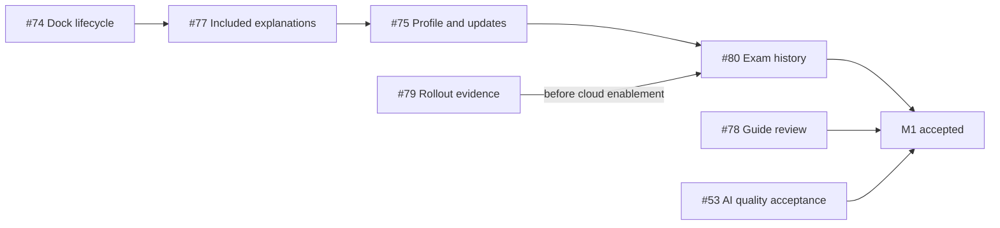

# M1 delivery coordination

Tracking issue: [#87](https://github.com/tuanvipandpro/quiz-app/issues/87). [Milestone 1](https://github.com/tuanvipandpro/quiz-app/milestone/1). Baseline inspected: master 648d9e1, 2026-11-05.

This MR contains only cross-issue sequencing and acceptance coordination for #87. Each M1 delivery issue has its own independent planning MR based directly on master. Issue-specific specs, designs, tasks and operational work packages live in those MRs, not in this coordination diff.

## Confirmed scope

- Owner-confirmed Profile MVP: Google account information plus QuizMos settings; custom identity/avatar editing is outside this MVP.
- Owner-confirmed history MVP: Exam history first; Practice retains its current draft/checkpoint flow.
- Proposed history storage, limits and archive-retention decisions are documented for review in the #80 MR.
- App AI activation is already delivered. The boundary CPU benchmark remains explicitly owner-deferred, not a passing claim or a reinstated M1 completion gate.

## Independent issue MRs

| Issue                                                      | Planning MR                                                 | Scope                                                         |
| ---------------------------------------------------------- | ----------------------------------------------------------- | ------------------------------------------------------------- |
| [#74](https://github.com/tuanvipandpro/quiz-app/issues/74) | [MR #89](https://github.com/tuanvipandpro/quiz-app/pull/89) | Dock lifecycle regression and correction                      |
| [#77](https://github.com/tuanvipandpro/quiz-app/issues/77) | [MR #90](https://github.com/tuanvipandpro/quiz-app/pull/90) | Included explanations and explicit AI entry                   |
| [#75](https://github.com/tuanvipandpro/quiz-app/issues/75) | [MR #91](https://github.com/tuanvipandpro/quiz-app/pull/91) | Google-info Profile, workspace menu and reviewed quiz updates |
| [#80](https://github.com/tuanvipandpro/quiz-app/issues/80) | [MR #92](https://github.com/tuanvipandpro/quiz-app/pull/92) | Exam-only history and progress dashboard                      |
| [#78](https://github.com/tuanvipandpro/quiz-app/issues/78) | [MR #93](https://github.com/tuanvipandpro/quiz-app/pull/93) | Substantive review of four study guides                       |
| [#79](https://github.com/tuanvipandpro/quiz-app/issues/79) | [MR #94](https://github.com/tuanvipandpro/quiz-app/pull/94) | Production custom-quiz rollout evidence                       |
| [#53](https://github.com/tuanvipandpro/quiz-app/issues/53) | [MR #95](https://github.com/tuanvipandpro/quiz-app/pull/95) | Remaining App AI output-quality acceptance                    |

Each planning MR changes only its own OpenSpec directory or operational-plan document. It can receive that same issue's implementation and evidence when the owner requests apply; a second setup MR is not mandatory. Planning readiness alone does not satisfy runtime/content/production acceptance. If the owner chooses to merge planning first, the later implementation remains separately tracked under the same issue.

## Recommended implementation order

The arrows describe integration order, not stacked planning branches. The planning diffs merge independently. #78/#79/#53 can progress independently; #80 domain/fixture work may start before #79 clears its production gate. #52 migration is outside M1.

## Shared delivery gates

- Each issue owns its stable requirement IDs, planned tests, unchecked implementation tasks and acceptance evidence. The five OpenSpec plans contain 20 requirements and 39 open implementation tasks; #79/#53 retain their existing rollout contracts.
- Preserve canonical bank/question IDs, account isolation, private-quiz instance/version semantics and checkpoint compatibility across changes. Do not silently migrate guest uploads or drafts into account storage.
- #79 reconciles the actual published Rules/indexes and rollout evidence while preserving closed #42 history. #80 still needs its own additive policy/index verification before cloud history is enabled.
- #53 separates completed rollout from remaining output-quality review and owner-deferred CPU-boundary work. New live inference/persistence checks use a current authorized account/budget and the existing release procedure.
- UI work uses the existing Ant Design/tokens/translations, relevant 320/390/412/768/1280px and landscape states, VN/EN, themes, keyboard/focus and reduced motion. Include the reported 360px dock case. Keep disposable evidence outside Git and describe emulation honestly.
- Land each behavior's tests and documentation with its issue MR. Run type/risk-appropriate checks and wait for required CI on the latest head. Merge only when requested, then verify applicable master CI/deploy/smoke before closing that delivery issue.

## Coordination verification and closure

For this documentation-only MR, verify formatting, local links, the issue-to-MR mapping and the absence of issue-specific payloads from its diff. Required CI still follows the actual diff; no runtime acceptance is claimed here.

#87 tracks preparation and coordination only. Keep all seven delivery issues open until their own accepted scopes and rollout gates pass. Completion of planning artifacts or the coordination MR does not complete M1.

## Next entry

Review the #74 plan in [MR #89](https://github.com/tuanvipandpro/quiz-app/pull/89) and continue that issue's MR with implementation when requested. The coordination MR may merge in any order; it has no local-file dependency on an unmerged issue plan.
